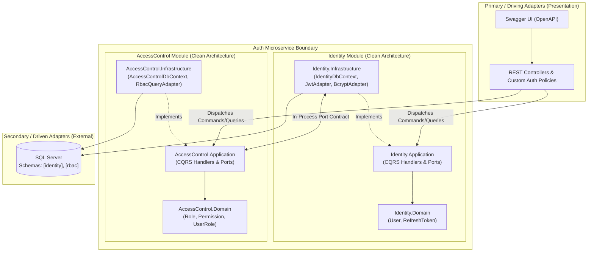

# System Architecture: Hexagonal, Modular & Clean Design

## 1. Architectural Synthesis
This microservice implements the exact structural hierarchy required:
**`Hexagonal Architecture (Macro)` ➔ `Modules (Meso)` ➔ `Clean Architecture (Micro)`**[cite: 1].

1. **Hexagonal Architecture (Ports & Adapters):**[cite: 1]
   - **Primary (Driving) Adapters:** `AuthService.API` (REST Controllers, Swagger UI, JWT Middleware) drives the application by invoking Inbound Ports (MediatR Commands/Queries)[cite: 1].
   - **Secondary (Driven) Adapters:** SQL Server (`EF Core`), `BCrypt` Password Hasher, `JwtTokenGenerator`, and Inter-Module Integration Adapters implement the Outbound Ports defined by the Application layer[cite: 1].
2. **Modular Partitioning:**[cite: 1]
   - The service is split into two autonomous modules: `Identity` (Authentication & Tokens) and `AccessControl` (RBAC: Roles & Permissions), supported by a common `SharedKernel`[cite: 1].
3. **Clean Architecture (Inside Each Module):**[cite: 1]
   - **Domain Layer:** Enterprise entities, value objects, enums, and domain errors.
   - **Application Layer:** Use cases (CQRS Handlers), FluentValidation validators, and Inbound/Outbound Port interfaces.
   - **Infrastructure Layer:** Adapter implementations, `DbContext`, EF configurations, and external SDKs.

---

## 2. Structural Architecture Diagram



---

## 3. Hexagonal Ports & Adapters Specification Matrix[cite: 1]

| Module | Port Name (Interface) | Port Type | Defined In | Adapter Implementation | Implemented In | Purpose |
| :--- | :--- | :--- | :--- | :--- | :--- | :--- |
| **Identity** | `IUserRepository` | Outbound Port | `Identity.Application` | `UserRepository` | `Identity.Infrastructure` | Persist and query `User` & `RefreshToken` aggregates in `[identity]` schema. |
| **Identity** | `IPasswordHasherPort` | Outbound Port | `Identity.Application` | `BcryptPasswordHasherAdapter` | `Identity.Infrastructure` | Hash plain-text passwords and verify hashes using BCrypt. |
| **Identity** | `IJwtProviderPort` | Outbound Port | `Identity.Application` | `JwtProviderAdapter` | `Identity.Infrastructure` | Generate signed JWT Access Tokens and cryptographic Refresh Tokens[cite: 1]. |
| **Identity** | `IRbacAccessPort` | Outbound Port | `Identity.Application` | `RbacAccessAdapter` | `AccessControl.Infrastructure`| Allows `Identity` module to fetch user roles/permissions at login and assign default role on registration[cite: 1]. |
| **AccessControl**| `IRoleRepository` | Outbound Port | `AccessControl.Application`| `RoleRepository` | `AccessControl.Infrastructure`| Manage `Role`, `Permission`, and `UserRole` entities in `[rbac]` schema[cite: 1]. |
| **AccessControl**| `IUserIdentityPort` | Outbound Port | `AccessControl.Application`| `UserIdentityAdapter` | `Identity.Infrastructure` | Verify `UserId` existence when assigning roles in the RBAC module. |

---

## 4. Target .NET Solution & Folder Structure

```text
AuthMicroservice/
├── AuthMicroservice.sln
├── docs/                                              # SDLC & Engineering Documentation
└── src/
    ├── Shared/
    │   └── SharedKernel/                              # Class Library (.NET 8)
    │       ├── Domain/ (Entity.cs, IDomainEvent.cs)
    │       ├── Application/ (Result.cs, Error.cs, ICommand.cs, IQuery.cs, ValidationBehavior.cs)
    │       └── Contracts/ (IRbacAccessPort.cs, IUserIdentityPort.cs)
    │
    ├── Modules/
    │   ├── Identity/
    │   │   ├── Identity.Domain/                       # Class Library (Zero Dependencies)
    │   │   │   ├── Entities/ (User.cs, RefreshToken.cs)
    │   │   │   ├── Enums/ (UserStatus.cs)
    │   │   │   └── Errors/ (IdentityErrors.cs)
    │   │   ├── Identity.Application/                  # Class Library (Ref: Identity.Domain, SharedKernel)
    │   │   │   ├── Abstractions/Ports/ (IJwtProviderPort.cs, IPasswordHasherPort.cs, IUserRepository.cs)
    │   │   │   └── Features/ (Register/, Login/, RefreshToken/, RevokeToken/, GetMe/)
    │   │   └── Identity.Infrastructure/               # Class Library (Ref: Identity.Application)
    │   │       ├── Persistence/ (IdentityDbContext.cs, Configurations/, Repositories/)
    │   │       ├── Security/ (JwtProviderAdapter.cs, BcryptPasswordHasherAdapter.cs, JwtOptions.cs)
    │   │       └── DependencyInjection.cs
    │   │
    │   └── AccessControl/
    │       ├── AccessControl.Domain/                  # Class Library (Zero Dependencies)
    │       │   ├── Entities/ (Role.cs, Permission.cs, RolePermission.cs, UserRole.cs)
    │       │   └── Errors/ (RbacErrors.cs)
    │       ├── AccessControl.Application/             # Class Library (Ref: AccessControl.Domain, SharedKernel)
    │       │   ├── Abstractions/Ports/ (IRoleRepository.cs, IPermissionRepository.cs)
    │       │   └── Features/ (CreateRole/, GetRoles/, AssignPermissions/, AssignUserRole/)
    │       └── AccessControl.Infrastructure/          # Class Library (Ref: AccessControl.Application)
    │           ├── Persistence/ (AccessControlDbContext.cs, Configurations/, Repositories/)
    │           ├── Integration/ (RbacAccessAdapter.cs)
    │           └── DependencyInjection.cs
    │
    └── Host/
        └── AuthService.API/                           # ASP.NET Core Web API (Primary Adapter)
            ├── Controllers/ (AuthController.cs, RbacController.cs)
            ├── Authorization/ (HasPermissionAttribute.cs, PermissionAuthorizationHandler.cs)
            ├── Middleware/ (GlobalExceptionHandler.cs)
            ├── Extensions/ (SwaggerExtensions.cs, MigrationExtensions.cs)
            ├── appsettings.json
            └── Program.cs
```

---

## 5. Architecture Decision Records (ADRs)

### ADR-001: Custom Domain Entities vs. ASP.NET Core Identity
* **Context:** We need a clean domain model for Users, Roles, and Permissions while strictly adhering to Clean and Hexagonal Architecture[cite: 1].
* **Decision:** Use custom Pure C# Domain Entities (`User`, `Role`, `Permission`) rather than inheriting from `Microsoft.AspNetCore.Identity.IdentityUser`.
* **Rationale:** `ASP.NET Core Identity` couples the `Domain` layer to EF Core stores and framework-specific attributes, violating Clean Architecture's zero-dependency rule[cite: 1]. Custom entities provide complete control over the RBAC permission schema and keep the Domain layer 100% pure[cite: 1].

### ADR-002: Database Schema Isolation per Module (`[identity]` vs `[rbac]`)
* **Context:** Both modules run within the same microservice and share a SQL Server database, but must maintain logical independence[cite: 1].
* **Decision:** Use separate EF Core `DbContext` classes (`IdentityDbContext` and `AccessControlDbContext`) mapped to distinct SQL schemas (`[identity]` and `[rbac]`).
* **Rationale:** Prevents cross-module table coupling and ensures either module can be extracted into a separate physical microservice in the future with zero domain refactoring[cite: 1].

### ADR-003: Permission Claims Embedded in JWT[cite: 1]
* **Context:** Every protected API call requires permission verification[cite: 1].
* **Decision:** Embed the user's resolved `roles` and `permissions` arrays directly inside the JWT payload during token generation[cite: 1].
* **Rationale:** Enables stateless, zero-latency authorization checks at the API gateway or controller level via custom `IAuthorizationHandler` without hitting SQL Server on every request.