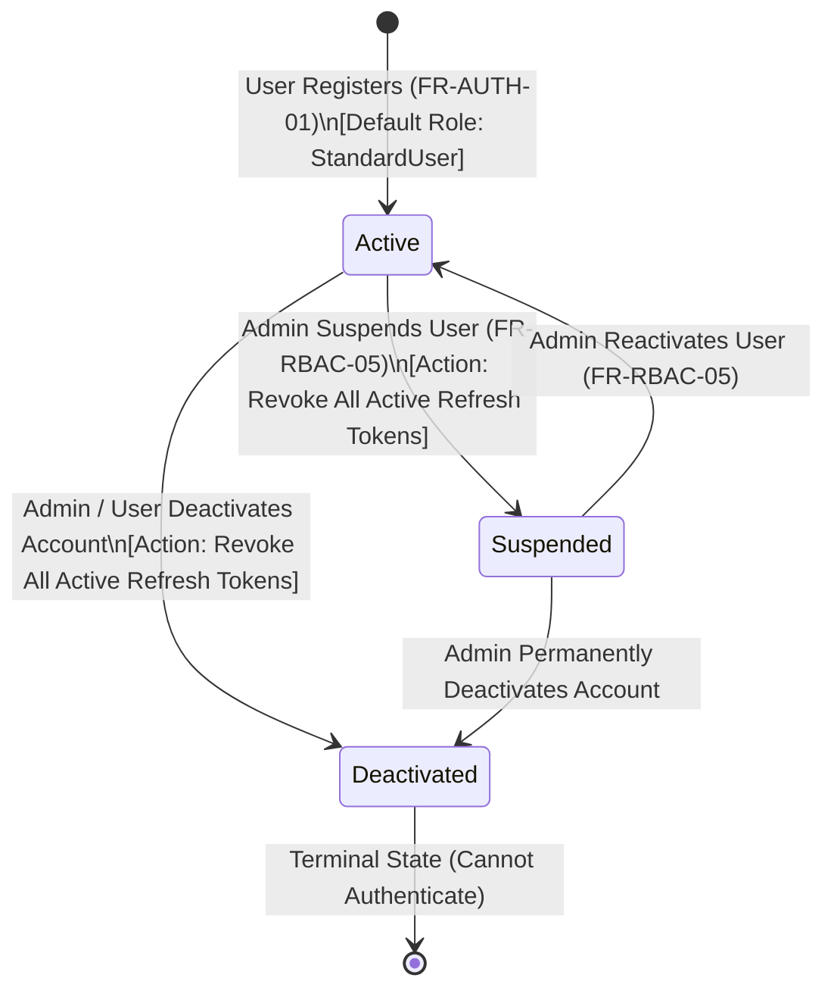
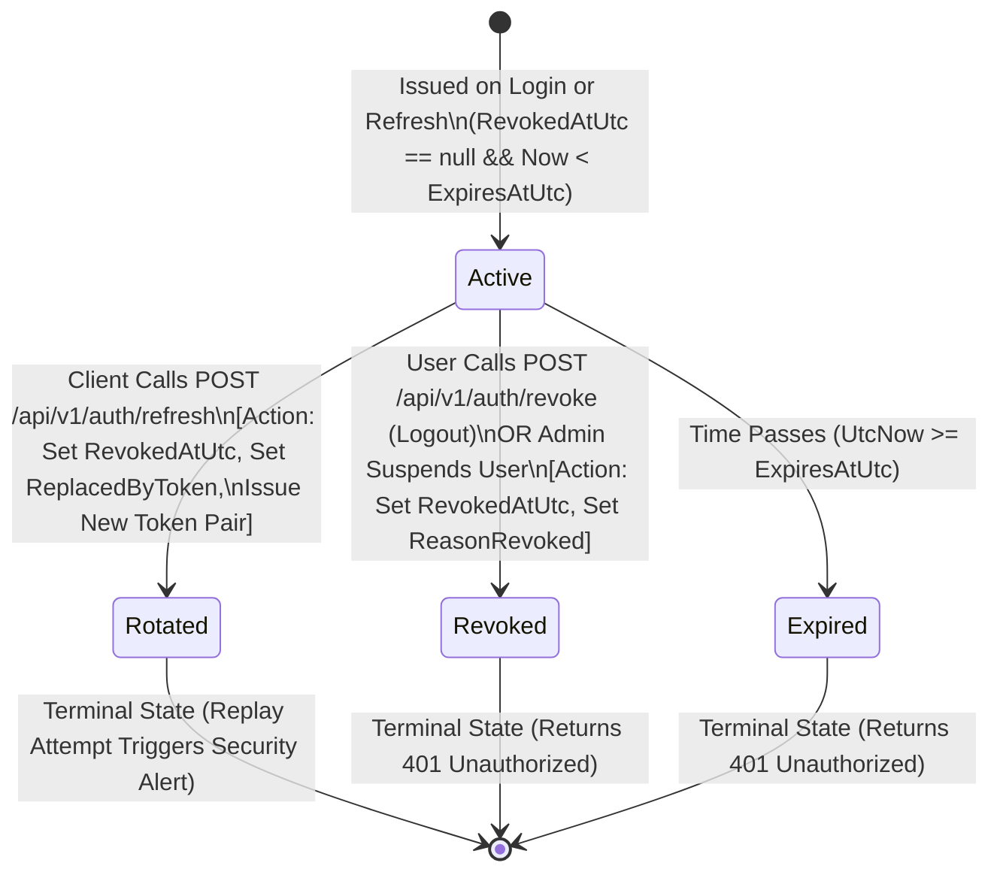
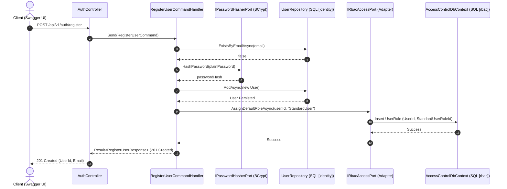
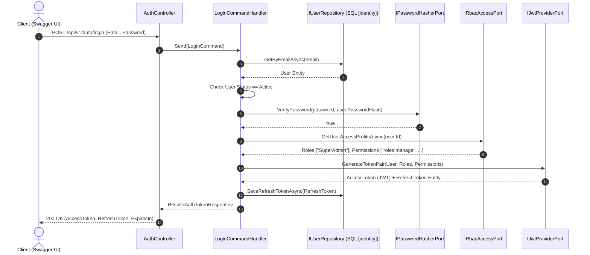
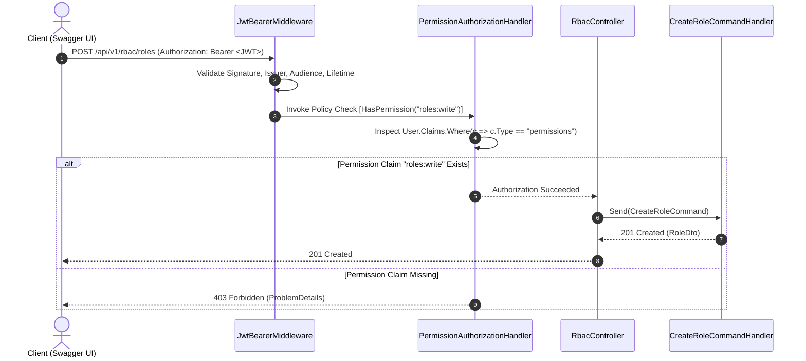

# System Behavior: State Machines & Sequence Workflows

## 1. State Machine Diagrams

### 1.1 User Account Lifecycle State Diagram
This state machine governs the `User.Status` property inside the `Identity.Domain` layer. Only users in the `Active` state can authenticate or refresh tokens.

---

### 1.2 Refresh Token Lifecycle State Diagram
This state machine governs the security lifecycle of a `RefreshToken` entity to prevent replay attacks via **Refresh Token Rotation**.

---

## 2. Sequence Diagrams

### 2.1 User Registration & Cross-Module Default Role Assignment

---

### 2.2 Login, Cross-Module Claim Aggregation & JWT Issuance[cite: 1]

---

### 2.3 Policy-Based RBAC Authorization Flow[cite: 1]

