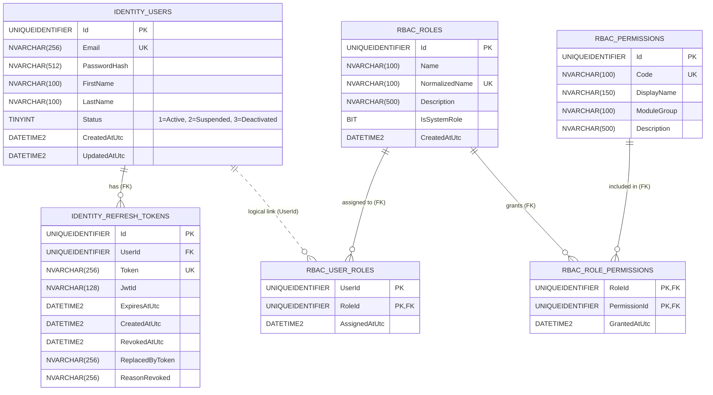

# Database Design, Data Dictionary & SQL Server DDL

## 1. Entity-Relationship Diagram (ERD)
The microservice utilizes a single SQL Server database logically partitioned into two schemas: `[identity]` and `[rbac]`[cite: 1]. Cross-schema relationships (`UserId`) are enforced at the Application layer via Hexagonal Ports rather than physical cross-schema Foreign Keys to preserve module autonomy[cite: 1].



---

## 2. Data Dictionary

### 2.1 Schema: `[identity]`
#### Table: `[identity].[Users]`
| Column | Data Type | Nullable | Constraints / Indexes | Description |
| :--- | :--- | :--- | :--- | :--- |
| `Id` | `UNIQUEIDENTIFIER` | No | `PK_Users` | Primary Key (Generated in Domain). |
| `Email` | `NVARCHAR(256)` | No | `UX_Users_Email` (Unique) | Normalized lowercase user email. |
| `PasswordHash` | `NVARCHAR(512)` | No | - | BCrypt hashed password string. |
| `FirstName` | `NVARCHAR(100)` | No | - | User's first name. |
| `LastName` | `NVARCHAR(100)` | No | - | User's last name. |
| `Status` | `TINYINT` | No | `DEFAULT (1)` | `1` = Active, `2` = Suspended, `3` = Deactivated. |
| `CreatedAtUtc` | `DATETIME2(7)` | No | - | Creation UTC timestamp. |
| `UpdatedAtUtc` | `DATETIME2(7)` | Yes | - | Last update UTC timestamp. |

#### Table: `[identity].[RefreshTokens]`
| Column | Data Type | Nullable | Constraints / Indexes | Description |
| :--- | :--- | :--- | :--- | :--- |
| `Id` | `UNIQUEIDENTIFIER` | No | `PK_RefreshTokens` | Primary Key. |
| `UserId` | `UNIQUEIDENTIFIER` | No | `FK_RefreshTokens_Users`, `IX_UserId` | Owning user reference (`ON DELETE CASCADE`). |
| `Token` | `NVARCHAR(256)` | No | `UX_RefreshTokens_Token` (Unique) | Secure random Base64 token string. |
| `JwtId` | `NVARCHAR(128)` | No | - | Matches the `jti` claim of the paired JWT[cite: 1]. |
| `ExpiresAtUtc` | `DATETIME2(7)` | No | - | Expiration UTC timestamp (7 days). |
| `CreatedAtUtc` | `DATETIME2(7)` | No | - | Issuance UTC timestamp. |
| `RevokedAtUtc` | `DATETIME2(7)` | Yes | - | Null if active; populated when rotated or revoked. |
| `ReplacedByToken`| `NVARCHAR(256)` | Yes | - | Points to the new token issued during rotation. |
| `ReasonRevoked` | `NVARCHAR(256)` | Yes | - | Audit reason (`Rotated`, `UserLogout`, `AdminSuspended`). |

---

### 2.2 Schema: `[rbac]`[cite: 1]
#### Table: `[rbac].[Roles]`
| Column | Data Type | Nullable | Constraints / Indexes | Description |
| :--- | :--- | :--- | :--- | :--- |
| `Id` | `UNIQUEIDENTIFIER` | No | `PK_Roles` | Primary Key. |
| `Name` | `NVARCHAR(100)` | No | - | Display name of the role (e.g., `SuperAdmin`). |
| `NormalizedName`| `NVARCHAR(100)` | No | `UX_Roles_NormalizedName` (Unique)| Uppercase invariant name (`SUPERADMIN`). |
| `Description` | `NVARCHAR(500)` | Yes | - | Role purpose description. |
| `IsSystemRole` | `BIT` | No | `DEFAULT (0)` | Protects seeded core roles from mutation/deletion. |
| `CreatedAtUtc` | `DATETIME2(7)` | No | - | Creation UTC timestamp. |

#### Table: `[rbac].[Permissions]`
| Column | Data Type | Nullable | Constraints / Indexes | Description |
| :--- | :--- | :--- | :--- | :--- |
| `Id` | `UNIQUEIDENTIFIER` | No | `PK_Permissions` | Primary Key. |
| `Code` | `NVARCHAR(100)` | No | `UX_Permissions_Code` (Unique) | Permission identifier (e.g., `roles:manage`). |
| `DisplayName` | `NVARCHAR(150)` | No | - | Human-readable label. |
| `ModuleGroup` | `NVARCHAR(100)` | No | - | Grouping category (`Identity`, `AccessControl`). |
| `Description` | `NVARCHAR(500)` | Yes | - | Detailed description of the permission. |

#### Table: `[rbac].[RolePermissions]`
| Column | Data Type | Nullable | Constraints / Indexes | Description |
| :--- | :--- | :--- | :--- | :--- |
| `RoleId` | `UNIQUEIDENTIFIER` | No | `PK`, `FK_RolePermissions_Roles` | Reference to `[rbac].[Roles]`. |
| `PermissionId` | `UNIQUEIDENTIFIER` | No | `PK`, `FK_RolePermissions_Perms` | Reference to `[rbac].[Permissions]`. |
| `GrantedAtUtc` | `DATETIME2(7)` | No | - | Timestamp when permission was linked. |

#### Table: `[rbac].[UserRoles]`
| Column | Data Type | Nullable | Constraints / Indexes | Description |
| :--- | :--- | :--- | :--- | :--- |
| `UserId` | `UNIQUEIDENTIFIER` | No | `PK`, `IX_UserRoles_UserId` | Logical reference to `[identity].[Users](Id)`. |
| `RoleId` | `UNIQUEIDENTIFIER` | No | `PK`, `FK_UserRoles_Roles` | Reference to `[rbac].[Roles](Id)`. |
| `AssignedAtUtc` | `DATETIME2(7)` | No | - | Timestamp when role was assigned to user. |

---

## 3. SQL Server Physical DDL Script

```sql
-- Create Isolated Schemas
IF NOT EXISTS (SELECT * FROM sys.schemas WHERE name = 'identity') EXEC('CREATE SCHEMA [identity]');
GO
IF NOT EXISTS (SELECT * FROM sys.schemas WHERE name = 'rbac') EXEC('CREATE SCHEMA [rbac]');
GO

-- [identity].[Users]
CREATE TABLE [identity].[Users] (
    [Id] UNIQUEIDENTIFIER NOT NULL,
    [Email] NVARCHAR(256) NOT NULL,
    [PasswordHash] NVARCHAR(512) NOT NULL,
    [FirstName] NVARCHAR(100) NOT NULL,
    [LastName] NVARCHAR(100) NOT NULL,
    [Status] TINYINT NOT NULL CONSTRAINT [DF_Users_Status] DEFAULT (1),
    [CreatedAtUtc] DATETIME2(7) NOT NULL,
    [UpdatedAtUtc] DATETIME2(7) NULL,
    CONSTRAINT [PK_Users] PRIMARY KEY CLUSTERED ([Id] ASC)
);
CREATE UNIQUE NONCLUSTERED INDEX [UX_Users_Email] ON [identity].[Users] ([Email] ASC);
GO

-- [identity].[RefreshTokens]
CREATE TABLE [identity].[RefreshTokens] (
    [Id] UNIQUEIDENTIFIER NOT NULL,
    [UserId] UNIQUEIDENTIFIER NOT NULL,
    [Token] NVARCHAR(256) NOT NULL,
    [JwtId] NVARCHAR(128) NOT NULL,
    [ExpiresAtUtc] DATETIME2(7) NOT NULL,
    [CreatedAtUtc] DATETIME2(7) NOT NULL,
    [RevokedAtUtc] DATETIME2(7) NULL,
    [ReplacedByToken] NVARCHAR(256) NULL,
    [ReasonRevoked] NVARCHAR(256) NULL,
    CONSTRAINT [PK_RefreshTokens] PRIMARY KEY CLUSTERED ([Id] ASC),
    CONSTRAINT [FK_RefreshTokens_Users] FOREIGN KEY ([UserId]) REFERENCES [identity].[Users] ([Id]) ON DELETE CASCADE
);
CREATE UNIQUE NONCLUSTERED INDEX [UX_RefreshTokens_Token] ON [identity].[RefreshTokens] ([Token] ASC);
CREATE NONCLUSTERED INDEX [IX_RefreshTokens_UserId] ON [identity].[RefreshTokens] ([UserId] ASC);
GO

-- [rbac].[Roles]
CREATE TABLE [rbac].[Roles] (
    [Id] UNIQUEIDENTIFIER NOT NULL,
    [Name] NVARCHAR(100) NOT NULL,
    [NormalizedName] NVARCHAR(100) NOT NULL,
    [Description] NVARCHAR(500) NULL,
    [IsSystemRole] BIT NOT NULL CONSTRAINT [DF_Roles_IsSystemRole] DEFAULT (0),
    [CreatedAtUtc] DATETIME2(7) NOT NULL,
    CONSTRAINT [PK_Roles] PRIMARY KEY CLUSTERED ([Id] ASC)
);
CREATE UNIQUE NONCLUSTERED INDEX [UX_Roles_NormalizedName] ON [rbac].[Roles] ([NormalizedName] ASC);
GO

-- [rbac].[Permissions]
CREATE TABLE [rbac].[Permissions] (
    [Id] UNIQUEIDENTIFIER NOT NULL,
    [Code] NVARCHAR(100) NOT NULL,
    [DisplayName] NVARCHAR(150) NOT NULL,
    [ModuleGroup] NVARCHAR(100) NOT NULL,
    [Description] NVARCHAR(500) NULL,
    CONSTRAINT [PK_Permissions] PRIMARY KEY CLUSTERED ([Id] ASC)
);
CREATE UNIQUE NONCLUSTERED INDEX [UX_Permissions_Code] ON [rbac].[Permissions] ([Code] ASC);
GO

-- [rbac].[RolePermissions]
CREATE TABLE [rbac].[RolePermissions] (
    [RoleId] UNIQUEIDENTIFIER NOT NULL,
    [PermissionId] UNIQUEIDENTIFIER NOT NULL,
    [GrantedAtUtc] DATETIME2(7) NOT NULL,
    CONSTRAINT [PK_RolePermissions] PRIMARY KEY CLUSTERED ([RoleId] ASC, [PermissionId] ASC),
    CONSTRAINT [FK_RolePermissions_Roles] FOREIGN KEY ([RoleId]) REFERENCES [rbac].[Roles] ([Id]) ON DELETE CASCADE,
    CONSTRAINT [FK_RolePermissions_Permissions] FOREIGN KEY ([PermissionId]) REFERENCES [rbac].[Permissions] ([Id]) ON DELETE CASCADE
);
GO

-- [rbac].[UserRoles]
CREATE TABLE [rbac].[UserRoles] (
    [UserId] UNIQUEIDENTIFIER NOT NULL,
    [RoleId] UNIQUEIDENTIFIER NOT NULL,
    [AssignedAtUtc] DATETIME2(7) NOT NULL,
    CONSTRAINT [PK_UserRoles] PRIMARY KEY CLUSTERED ([UserId] ASC, [RoleId] ASC),
    CONSTRAINT [FK_UserRoles_Roles] FOREIGN KEY ([RoleId]) REFERENCES [rbac].[Roles] ([Id]) ON DELETE CASCADE
);
CREATE NONCLUSTERED INDEX [IX_UserRoles_UserId] ON [rbac].[UserRoles] ([UserId] ASC);
GO
```