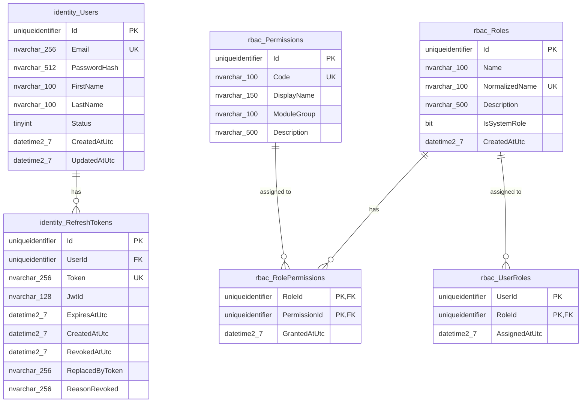

# Comprehensive Architectural & Feature Audit Report

**Date:** October 2026  
**Target Solution:** Enterprise Authentication & Role-Based Access Control (RBAC) Microservice  
**Audit Scope:** 
1. **User Implementation** (`src/`): Modular Clean Architecture & Hexagonal Ports/Adapters (`Identity`, `AccessControl`, `SharedKernel`, `Host`)
2. **Raneem's Implementation** (`Raneem/Auth/`): Authentication, OTP, Multi-channel notifications & credentials
3. **Marwan's Implementation** (`Marwan/Authentication/`): ASP.NET Core Identity, OAuth2 / Social Logins, Rate Limiting & Cookies
4. **Third Teammate's Implementation** (`Raneem/users/`): User management, Magic Links, and gRPC service

---

## Executive Summary

A comprehensive architectural and code-level audit was conducted across all codebase implementations in the workspace. Each team member approached authentication and identity from distinct paradigms:

- **The User (`src/`)** engineered an enterprise-grade **Clean Architecture with Hexagonal Ports & Adapters**, employing **CQRS (MediatR)**, the **Result Pattern**, FluentValidation pipeline behaviors, and strict **schema isolation** between `identity` and `rbac`. It is the only codebase featuring a dynamic, permission-based RBAC engine and zero cross-schema database foreign keys.
- **Marwan (`Marwan/Authentication/`)** built a feature-rich authentication solution leveraging **ASP.NET Core Identity** and **EF Core** under schema `iam` on **.NET 10.0**, featuring extensive OAuth2/social login integrations (Google, Facebook, GitHub, LinkedIn, Microsoft), HttpOnly cookie-based JWT tokens, and ASP.NET Core rate limiting. However, it tightly couples domain entities to Microsoft Identity primitives and suffers from critical edge-case flaws in OAuth error handling and profile validation.
- **Raneem (`Raneem/Auth/`)** focused on a real-world, mobile-first onboarding flow featuring **phone/WhatsApp OTP verification (via UltraMsg)**, passwordless mobile authentication, and web login with HttpOnly refresh cookies. However, it exhibits significant architectural debt: split credential tables without an overarching user aggregate, raw exception throwing for flow control, commented-out dead code, and severe security leaks (OTP codes printed to the console and exposed in API response payloads).
- **The Third Teammate (`Raneem/users/`)** attempted to build a standalone `Users` service with gRPC and REST interfaces. However, it created a severe architectural antipattern: while communicating with Auth via gRPC, it simultaneously maps and directly writes to Auth's private database tables (`IAM_Authentication_Email`, `IAM_Authentication_Phone`) within its own `UsersDbContext`.

---

## 1. Folder Structure & Architecture Comparison

### High-Level Comparison Matrix

| Architectural Dimension | User Implementation (`src/`) | Marwan (`Marwan/Authentication/`) | Raneem (`Raneem/Auth/`) | Third Teammate (`Raneem/users/`) |
| :--- | :--- | :--- | :--- | :--- |
| **Architecture Pattern** | Modular Clean Architecture & Hexagonal (Ports & Adapters) | Layered Clean Architecture (Domain / Application / Infrastructure / Presentation) | Use-Case Driven Hexagonal (Incomplete separation) | Use-Case Driven Layered (Inconsistent boundaries) |
| **Ports & Adapters** | **Yes (Strict)**: Outbound ports in `SharedKernel.Contracts` & modules; Adapters in Infrastructure | **Partial**: Interfaces in Application layer, implemented in Infrastructure; no formal Driving/Driven port separation | **Partial**: Defines `ports/outbound` and `ports/inbound`, but bypassed in places | **Partial**: Defines `ports/outbounds`, but directly accesses Auth database tables |
| **Controllers Location** | `src/Host/AuthService.API/Controllers/` (`AuthController.cs`, `RbacController.cs`) | `Marwan/Authentication/dotnet/Authentication.Presentation/Controllers/` (`AuthenticationController.cs`) | `Raneem/Auth/dotnet/presentation/rest/` (Multiple granular controllers, several commented out) | `Raneem/users/dotnet/presentation/rest/` (`UsersController.cs`) |
| **MediatR / CQRS** | **Yes**: Commands, Queries, Handlers, and `ValidationBehavior` pipeline behavior | **No**: Single service orchestrator (`AuthenticationService.cs`) called directly by controller | **No**: Individual command classes (e.g. `LoginWebCommand`, `RegisterCommand`) instantiated directly via DI | **No**: Individual command/query classes (e.g. `CreateUserCommand`) instantiated directly via DI |
| **Target Framework** | **.NET 8.0** (C# 12) | **.NET 10.0** (C# 13 preview / .NET 10 preview) | **.NET 10.0** | **.NET 10.0** |
| **Identity Mechanism** | Pure custom Domain Entities (`User`, `RefreshToken`, `Role`, `Permission`) | `Microsoft.AspNetCore.Identity.EntityFrameworkCore` (`IdentityUser<Guid>`) | Custom split credential tables (`Email`, `Phone`, `Password`, `PendingRegistration`) | Anemic User entity (`UserId`, `IsDeleted`, `DeletedAt`) |
| **API Protocols** | REST (ASP.NET Core Web API, Swagger) | REST (Scalar API Reference & OpenAPI) | REST + **gRPC** (`AuthGrpcService`) | REST + **gRPC** (`UserGrpcService`) |
| **Inter-Module Comms** | In-process Hexagonal Ports (`IRbacAccessPort`, `IUserIdentityPort`) | Monolithic / N/A | Inter-service gRPC (`HrGrpcClient`) | Inter-service gRPC (`AuthGrpcClient`) + Shared DB |
| **Extraneous Files** | None (Clean repository) | Unused Python DDD template files in `python/` directory | Unused Python DDD template files in `dotnet/` subfolders | Unused Python DDD template files in `dotnet/` subfolders |

---

### Detailed Architectural Breakdown

#### 1. User's Implementation (`src/`)
- **Structure**:
  ```plaintext
  src/
  ├── Host/
  │   └── AuthService.API/          # Driving Adapter: ASP.NET Core API, Middleware, Swagger, DI Composition
  ├── Modules/
  │   ├── Identity/                 # Bounded Context: Authentication & Token Lifecycle
  │   │   ├── Identity.Domain/      # User aggregate, RefreshToken, UserStatus enum, IdentityErrors
  │   │   ├── Identity.Application/ # Login, Register, Refresh, Revoke CQRS Commands & Validators
  │   │   └── Identity.Infrastructure/# EF Core IdentityDbContext, BCrypt Hasher, JWT Provider
  │   └── AccessControl/            # Bounded Context: Dynamic Role-Based Access Control
  │       ├── AccessControl.Domain/ # Role, Permission, RolePermission, UserRole aggregates
  │       ├── AccessControl.Application/# RBAC CQRS Commands & Queries, FluentValidators
  │       └── AccessControl.Infrastructure/# EF Core AccessControlDbContext, RbacRepository
  └── Shared/
      └── SharedKernel/             # Result pattern, Domain primitives, Outbound Port Contracts
  ```
- **Strengths**:
  - Follows strict **Domain-Driven Design (DDD)** and **Hexagonal Architecture**.
  - **Zero Database Cross-Schema Foreign Keys**: `Identity` and `AccessControl` live in the same physical database but reside in isolated schemas (`identity` and `rbac`). They reference each other only via unconstrained `Guid UserId` identifiers.
  - **Strict Dependency Inversion**: Application depends only on interfaces defined within its own abstractions or `SharedKernel`. Concrete EF Core, BCrypt, and JWT implementations reside purely in Infrastructure adapters (`RbacAccessAdapter`, `UserIdentityAdapter`, `JwtProviderAdapter`, `BcryptPasswordHasherAdapter`).
  - **Enterprise Pipeline**: Uses MediatR with automatic FluentValidation behavior and an RFC 7807 Problem Details mapping extension.

#### 2. Marwan's Implementation (`Marwan/Authentication/`)
- **Structure**:
  ```plaintext
  Marwan/Authentication/
  ├── dotnet/
  │   ├── Authentication.Domain/          # ApplicationUser, EmailVerificationOtp, RefreshToken, UserStatus
  │   ├── Authentication.Application/     # DTOs, Exceptions, Interfaces, AuthenticationService
  │   ├── Authentication.Infrastructure/  # EF Core IamDbContext, Social Auth, Smtp, Jwt, OtpHasher
  │   └── Authentication.Presentation/    # AuthenticationController, Middlewares, Program.cs
  ├── tests/                              # Unit/Integration tests for Social Auth, Cookies, Tokens
  └── python/                             # Leftover Python DDD scaffolding templates (non-functional)
  ```
- **Strengths**:
  - Implements **ASP.NET Core Identity** (`AddIdentityCore<ApplicationUser>()`), providing battle-tested hashing, security stamps, token providers, and lockout management.
  - Features robust **Rate Limiting** configured via Microsoft ASP.NET Core rate limiting middleware with distinct policies (`AuthSensitive`, `AuthEmail`, `AuthLogin`).
  - Implements **HttpOnly SameSite cookies** for both access and refresh tokens via `AuthenticationCookieService`.
  - Replaces traditional Swagger with **Scalar** (`MapScalarApiReference()`) for modern interactive API documentation.
- **Weaknesses**:
  - Domain layer is coupled to `Microsoft.AspNetCore.Identity` (`ApplicationUser : IdentityUser<Guid>`).
  - Missing CQRS: All business workflows reside inside a single monolithic service (`AuthenticationService.cs`), which takes 13 injected dependencies in its constructor.
  - Leftover artifact files: Contains an entire `python/` directory with Python DDD domain templates that were likely generated by an external agent and abandoned.

#### 3. Raneem's Implementation (`Raneem/Auth/`)
- **Structure**:
  ```plaintext
  Raneem/Auth/dotnet/
  ├── domain/           # Separate credential entities: Email, Phone, Password, Otp, RefreshToken, etc.
  ├── application/      # Granular use-case command classes (LoginCommand, RegisterCommand, etc.)
  ├── infrastructure/   # AuthenticationDbContext, Smtp, UltraMsg WhatsApp, JwtService, Grpc clients
  └── presentation/     # Granular controllers per endpoint, AuthGrpcService, Program.cs
  ```
- **Strengths**:
  - Real-world integration with **UltraMsg WhatsApp API** for OTP messaging.
  - Dual token issuing: Distinct token lifecycles and secret signing for Web (`JwtServiceWeb`) vs Mobile (`JwtService`).
  - Exposes both HTTP REST endpoints and **gRPC endpoints** (`AuthGrpcService`) on separate Kestrel protocol ports (7130 for HTTPS/H2, 5166 for HTTP/H1).
- **Weaknesses**:
  - **No User Aggregate**: A user does not exist as a primary entity. Instead, user identity is fragmented across `IAM_Authentication_Email`, `IAM_Authentication_Phone`, and `IAM_Authentication_Password`, tied together by an unvalidated `Guid UserId`.
  - **Severe Dead/Commented Code**: Several controllers (`AuthController.cs`, `VerifyRegisterOtpController.cs`, `VerifyLoginOtpController.cs`, `ResetPasswordController.cs`) are completely commented out, while `PasswordResetTokenController.cs` is a 0-byte empty file.
  - **No CQRS Mediator**: Each command is a raw C# class injected directly into controllers without pipeline validation or consistent result wrapping.

#### 4. The Third Teammate's Implementation (`Raneem/users/`)
- **Structure**:
  ```plaintext
  Raneem/users/dotnet/
  ├── domain/           # User, UserEmail, UserPhone, SetPasswordToken entities
  ├── application/      # Commands (CreateUser, UpdateUser, DeleteUser) & Queries (GetUserById, GetUserByPhone)
  ├── infrastructure/   # UsersDbContext, AuthGrpcClient, UserRepository, SmtpEmailService
  └── presentation/     # UsersController (REST), UserGrpcService (gRPC), Program.cs
  ```
- **Strengths**:
  - Implements Magic Link account activation (`SetPasswordToken`) sent via email on admin user creation.
  - Comprehensive gRPC service (`UserGrpcService`) for inter-service communication.
- **Weaknesses**:
  - **Catastrophic Database Coupling**: `UsersDbContext` directly maps tables belonging to the Auth service (`IAM_Authentication_Email`, `IAM_Authentication_Phone`, `IAM_Authentication_SetPasswordToken`) and enforces foreign key cascades against `IAM_USER_User`.
  - **Architectural Schizophrenia**: It calls Auth over gRPC (`AuthGrpcClient.GetUserAuthInfoAsync`, `DeleteAuthenticationAsync`) to fetch user auth data, yet simultaneously queries the exact same authentication tables directly through EF Core in `UserRepository.cs`.
  - The REST interface is virtually abandoned: `UsersController` exposes only a single `POST api/users` endpoint; all other queries and commands are accessible only via gRPC.

---

## 2. Feature Inventory & In-Depth Technical Audits

---

### A. Raneem's Code: Exact Features & Endpoints

#### 1. Active REST Endpoints

| HTTP Method | Route | Controller File | Request DTO | Response / Behavior |
| :--- | :--- | :--- | :--- | :--- |
| `POST` | `api/auth/register` | `RegisterController.cs` | `RegisterRequest` (`Name`, `Email`, `CountryCode`, `PhoneNumber`, `Password`, `ProjectType`) | Creates/updates `PendingRegistration`, generates OTP, sends via WhatsApp, returns `{ Message, OtpCode }`. |
| `POST` | `api/auth/verify-otp` | `ResendRegisterOtpController.cs` (`VerifyOtpController`) | `OtpCommandRequest` (`Email`, `CountryCode`, `PhoneNumber`, `Code`, `CommandType`) | Validates OTP. If `CommandType == "Register"`, completes registration, calls `HrGrpcClient.CreatePassengerAsync`, saves user credentials, sets HttpOnly refresh cookie, returns access token. If `CommandType == "Login"`, validates OTP, sets refresh cookie, returns tokens. |
| `POST` | `api/auth/resend-otp` | `ResendRegisterOtpController.cs` (`VerifyOtpController`) | `OtpCommandRequest` (`Email`, `CountryCode`, `PhoneNumber`, `CommandType`) | Regenerates OTP for pending registration or active login, dispatches via WhatsApp. |
| `POST` | `api/auth/login/Mobile` | `LoginMobileController.cs` | `LoginRequest` (`CountryCode`, `PhoneNumber`, `ProjectType`) | Passwordless mobile login trigger: checks phone existence, generates 6-digit OTP, dispatches via WhatsApp. |
| `POST` | `api/auth/login/web` | `LoginWebController.cs` | `LoginWebRequest` (`Email`, `Password`, `RememberMe`) | Password-based login: verifies BCrypt hash, issues access token in body, sets HttpOnly refresh cookie (expires in 7 days or session based on `RememberMe`). |
| `POST` | `api/auth/refresh` | `RefreshTokenController.cs` | None (reads `refreshToken` from Cookie) | Validates cookie refresh token, rotates token in DB, appends new cookie, returns `{ accessToken }`. |
| `POST` | `api/auth/logout` | `LogoutController.cs` | None (reads `refreshToken` from Cookie) | Revokes refresh token in database, deletes `refreshToken` cookie from response. |
| `POST` | `api/auth/forgot-password`| `ForgotPasswordController.cs`| `ForgotPasswordRequest` (`Email`) | Generates reset token with 2-minute validity, emails link `http://localhost:4200/#/set-password?token={token}`. |
| `POST` | `api/auth/password` | `SetPasswordController.cs` (`ChangePasswordController`)| `ChangePasswordRequest` (`Token`, `NewPassword`) | Multi-purpose password setter: checks `SetPasswordToken` (invite flow) first; if null, checks `PasswordResetToken` (forgot password flow); updates password hash. |

#### 2. Commented-Out & Inactive REST Endpoints
- **`AuthController.cs`**: `POST api/auth/login` is completely commented out (lines 1–25). Replaced by `LoginMobileController` and `LoginWebController`.
- **`VerifyRegisterOtpController.cs`**: `POST api/auth/verify-register-otp` is completely commented out (lines 1–79). Merged into `ResendRegisterOtpController.cs`.
- **`VerifyLoginOtpController.cs`**: `POST api/auth/verify-login-otp` is completely commented out (lines 1–75). Merged into `ResendRegisterOtpController.cs`.
- **`ResetPasswordController.cs`**: `POST api/auth/reset-password` is completely commented out (lines 1–33). Handled by `SetPasswordController.cs` via `api/auth/password`.
- **`PasswordResetTokenController.cs`**: 0-byte blank file (contains no code).

#### 3. Active gRPC Endpoints (`AuthGrpcService.cs`)
- **`DeleteAuthentication`**: Accepts `DeleteAuthenticationRequest(UserId)`. Soft-deletes user credentials across `IAM_Authentication_Email`, `IAM_Authentication_Phone`, and `IAM_Authentication_Password`.
- **`GetUserAuthInfo`**: Accepts `GetUserAuthInfoRequest(UserId)`. Fetches name, primary email, country code, and phone number from authentication tables and returns `GetUserAuthInfoResponse`.

#### 4. Notification & Communication Integrations
- **WhatsApp**: Implemented in `UltraMsgWhatsAppService.cs` using HttpClient calling `https://api.ultramsg.com/{InstanceId}/messages/chat`. Hardcoded message template: `"Your Lady Driver verification code is: {otpCode}"`.
- **Email**: Implemented in `SmtpEmailService.cs` using `System.Net.Mail.SmtpClient`.
- **HR Service**: Outbound gRPC client in `HrGrpcClient.cs` invoking `HrService.HrServiceClient.CreatePassengerAsync(UserId)`.

#### 5. Critical Vulnerabilities & Code Defects in Raneem's Implementation
1. **Critical OTP Exposure in API Response**:
   In `RegisterCommand.cs` (lines 351–356) and `RegisterController.cs` (line 25):
   ```csharp
   Console.WriteLine(result.OtpCode); // Logged in plain text to stdout
   return new RegisterResponse
   {    
       Message = "OTP sent successfully.",
       OtpCode = otpCode // EXPOSED IN HTTP RESPONSE PAYLOAD!
   };
   ```
   Any attacker calling `POST api/auth/register` immediately receives the OTP code in the JSON response, completely defeating two-factor and SMS/WhatsApp verification.
2. **Exception-Driven Control Flow**:
   Errors are handled by throwing raw `System.Exception` and performing string comparisons in controllers:
   ```csharp
   if (ex.Message == "Phone number already exists.") return Conflict(...);
   ```
   If an exception message is modified or localized, the API falls back to returning HTTP 500 or 400 with internal stack traces.
3. **Hardcoded Frontend URLs**:
   Reset password links are hardcoded to `http://localhost:4200/#/set-password?token={token}` directly in the command handler rather than injected via configuration.

---

### B. Marwan's Code: OAuth2 & External Social Login Deep Dive

#### 1. External Social Providers Supported
Marwan built support for 5 external identity providers in `Marwan/Authentication/dotnet/Authentication.Infrastructure/Social/`:
1. **Google** (`GoogleAuthService.cs`)
2. **Facebook** (`FacebookAuthService.cs`)
3. **GitHub** (`GitHubAuthService.cs`)
4. **LinkedIn** (`LinkedInAuthService.cs`)
5. **Microsoft** (`MicrosoftAuthService .cs`)

#### 2. NuGet Packages Used
- **`Google.Apis.Auth` (v1.61.0)**: Used exclusively for Google ID token validation.
- **`Microsoft.AspNetCore.Identity.EntityFrameworkCore` (v10.0.12)**: Provides `UserManager<ApplicationUser>` and `UserLoginInfo` persistence.
- **`Microsoft.AspNetCore.Authentication.JwtBearer` (v10.0.12)**: Configures JWT validation and authentication middleware.

#### 3. Complete OAuth2 / Social Login Flow
```mermaid
sequenceDiagram
    autonumber
    actor Client as Frontend / Mobile App
    participant Ctrl as AuthenticationController
    participant Svc as AuthenticationService
    participant Provider as Social Provider Adapter
    participant Google as Google Identity Services
    participant Identity as UserManager / IamDbContext

    Client->>Ctrl: POST /api/auth/social-login { provider: "google", credential: "JWT" }
    Ctrl->>Svc: SocialLoginAsync(request)
    Svc->>Provider: ValidateAsync(credential)
    Provider->>Google: GoogleJsonWebSignature.ValidateAsync(credential, settings)
    Google--Provider: Validated Payload (Subject, Email, Name, EmailVerified)
    Provider-->>Svc: ExternalUserInfo(ProviderUserId, Email, Name)
    
    Svc->>Identity: FindByLoginAsync("Google", ProviderUserId)
    alt User Not Linked by Provider ID
        Svc->>Identity: FindByEmailAsync(Email)
        alt User Does Not Exist by Email
            Svc->>Identity: CreateAsync(new ApplicationUser { EmailConfirmed = true, Status = Active })
        else User Exists by Email
            Svc->>Identity: UpdateAsync(user with EmailConfirmed = true)
        end
        Svc->>Identity: AddLoginAsync(user, UserLoginInfo("Google", ProviderUserId))
    end
    
    Svc->>Svc: Verify user.Status == UserStatus.Active
    Svc->>Identity: Generate JWT Access Token & Refresh Token
    Svc->>Client: Set-Cookie: accessToken & refreshToken (HttpOnly, SameSite)
    Svc-->>Ctrl: Ok
    Ctrl-->>Client: 200 OK { message: "Login successful." }
```

1. **Client Request**: The frontend invokes `POST api/auth/social-login` with `{ "provider": "google", "credential": "<token_or_code>" }`.
2. **Provider Validation**:
   - For Google, `GoogleAuthService.ValidateAsync` executes:
     ```csharp
     var payload = await GoogleJsonWebSignature.ValidateAsync(
         credential,
         new GoogleJsonWebSignature.ValidationSettings
         {
             Audience = new[] { clientId }
         });
     ```
   - Checks `if (!payload.EmailVerified) return null;`.
   - Returns `new ExternalUserInfo(payload.Subject, payload.Email, payload.Name)`.
3. **Account Resolution & Auto-Provisioning**:
   - Queries `_userManager.FindByLoginAsync("Google", externalUser.ProviderUserId)`.
   - If not found, attempts fallback lookup via `_userManager.FindByEmailAsync(externalUser.Email)`.
   - If email is not found, creates a new `ApplicationUser` with `EmailConfirmed = true`, `Status = UserStatus.Active`, and splits the full name into `FirstName` and `LastName`.
   - If user exists by email, forces `user.EmailConfirmed = true` and updates the record.
   - Links the login provider via `_userManager.AddLoginAsync(user, new UserLoginInfo("Google", externalUser.ProviderUserId, "Google"))`.
4. **Token Issuance**: Generates JWT access token and refresh token, setting both as HttpOnly cookies in the response.

#### 4. Critical Missing Validation & Flaws in Marwan's Implementation

1. **Protocol Inconsistency across Providers (Architectural Flaw)**:
   There is a fundamental impedance mismatch in how `SocialLoginRequest.Credential` is interpreted:
   - For **Google**: `Credential` MUST be an OpenID Connect **ID Token** (JWT string).
   - For **Facebook**: `Credential` MUST be a Graph API **User Access Token**.
   - For **GitHub**, **LinkedIn**, and **Microsoft**: `Credential` MUST be an **OAuth2 Authorization Code**, which the backend then exchanges for an access token via an HTTP POST request.
   Having a single endpoint `POST api/auth/social-login` accept entirely different token types under the ambiguous field name `Credential` creates high client coupling and breaks REST contract expectations.
2. **Missing State & PKCE Validation (CSRF Vulnerability)**:
   For GitHub, LinkedIn, and Microsoft, the backend exchanges the authorization code for an access token without validating a `state` parameter or PKCE `code_verifier`. This exposes users to OAuth authorization code injection and CSRF login attacks.
3. **Empty Email Account Collision & Crash**:
   Providers like Facebook and GitHub do not guarantee that an email is returned (e.g. GitHub users with private emails, or Facebook users who unchecked the email permission).
   In `FacebookAuthService.cs`:
   ```csharp
   return new ExternalUserInfo(facebookUser.Id, facebookUser.Email ?? string.Empty, ...);
   ```
   In `AuthenticationService.cs`:
   ```csharp
   user = await _userManager.FindByEmailAsync(externalUser.Email); // Searches for ""!
   user = new ApplicationUser { UserName = "", Email = "" };
   await _userManager.CreateAsync(user); // Crashes or causes catastrophic account collision!
   ```
   No validation exists in `AuthenticationService.SocialLoginAsync` ensuring `!string.IsNullOrWhiteSpace(externalUser.Email)` before attempting account lookup or creation.
4. **Account Pre-Hijacking Vulnerability**:
   If an attacker registers an unverified account using victim `victim@example.com`, and later the victim signs in with Google using `victim@example.com`, Marwan's code automatically links the accounts:
   ```csharp
   if (!user.EmailConfirmed)
   {
       user.EmailConfirmed = true;
       await _userManager.UpdateAsync(user);
   }
   await _userManager.AddLoginAsync(user, ...);
   ```
   However, the attacker still knows the original local password set during registration! The attacker can subsequently log in using the local password and access the victim's account. Existing passwords must be reset or invalidated upon external linking.
5. **Configuration Crash (Unhandled Exception)**:
   In `GoogleAuthService.cs`:
   ```csharp
   if (string.IsNullOrWhiteSpace(clientId))
   {
       throw new InvalidOperationException("Google ClientId is not configured.");
   }
   ```
   If configuration keys `Google:ClientId` or `Authentication:Google:ClientId` are missing, an unhandled `InvalidOperationException` is thrown, returning an opaque HTTP 500 error instead of a graceful domain error.
6. **Error Suppression & Loss of Context**:
   `GoogleAuthService` catches `InvalidJwtException` and generic `Exception`, logs a warning, and returns `null`. The calling service then throws `UnauthorizedException("Invalid Google credentials.")`. Whether the token expired, the audience was rejected, or Google's public key endpoint was unreachable due to network failure, the root cause is completely swallowed.

---

### C. The Third Teammate's Folder: `Users` Module Implementation

#### 1. Entities and Fields

The third teammate's domain model is split into an anemic `User` aggregate and secondary contact entities located in `Raneem/users/dotnet/domain/entities/`:

1. **`User.cs` (`IAM_USER_User`)**:
   ```csharp
   public sealed class User
   {
       public Guid UserId { get; set; }
       public bool IsDeleted { get; set; }
       public DateTime? DeletedAt { get; set; }
   }
   ```
   *Audit Finding*: This entity has no name, no email, no password hash, and no status. It is purely an anchor record for a UUID with soft-delete flags.
2. **`UserPhone.cs` / `phone.cs` (`IAM_Authentication_Phone`)**:
   - `PhoneId`: `Guid?` (Primary Key)
   - `UserId`: `Guid?` (Foreign Key to `IAM_USER_User.UserId` with `Cascade` delete)
   - `CountryCode`: `string?` (max length 5)
   - `PhoneNumber`: `string?` (max length 20, composite unique index on `CountryCode` + `PhoneNumber`)
   - `Name`: `string?` (max length 200 - user's full name stored on the phone record!)
   - `IsPrimary`: `bool?`
   - `IsVerified`: `bool?`
3. **`UserEmail.cs` / `email.cs` (`IAM_Authentication_Email`)**:
   - `EmailId`: `Guid?` (Primary Key)
   - `UserId`: `Guid?` (Foreign Key to `IAM_USER_User.UserId` with `Cascade` delete)
   - `Email` / `EmailAddress`: `string?` (max length 255, unique index)
   - `IsPrimary`: `bool?`
   - `IsVerified`: `bool?`
4. **`SetPasswordToken.cs` (`IAM_Authentication_SetPasswordToken`)**:
   - `SetPasswordTokenId`: `Guid` (Primary Key)
   - `UserId`: `Guid` (Foreign Key to `IAM_USER_User.UserId` with `Cascade` delete)
   - `Token`: `string` (max length 255)
   - `CreatedAt`: `DateTime`
   - `ExpireAt`: `DateTime` (24-hour lifetime)
   - `IsUsed`: `bool`
5. **`PasswordResetToken.cs` (`IAM_Authentication_PasswordResetToken`)**:
   - `PasswordResetTokenId`: `Guid`
   - `UserId`: `Guid`
   - `Token`: `string` (max length 255)
   - `ExpireAt`: `DateTime`
   - `IsUsed`: `bool`
   - `CreatedAt`: `DateTime`

#### 2. Endpoints: REST vs. gRPC

##### REST Controller (`UsersController.cs`)
Exposes exactly **one endpoint**:
- **`POST api/users`**:
  - Request: `CreateUserRequestDto` (`Name`, `Email`, `CountryCode`, `PhoneNumber`).
  - Logic: Validates email and phone uniqueness in database, creates `User` in `IAM_USER_User`, creates `UserPhone` with `request.Name`, creates `UserEmail` (if email provided), creates a 24-hour `SetPasswordToken`, and sends an activation email with magic link `http://localhost:4200/#/set-password?token={token}`.
  - Returns: Created `User` entity.

##### gRPC Service (`UserGrpcService.cs`)
Exposes **six gRPC Remote Procedure Calls** implementing `UserService.UserServiceBase`:
1. **`CreateUser`**: Accepts `CreateUserRequest(Email, CountryCode, PhoneNumber)`. Calls `CreateUserCommand.ExecuteAsync` without name.
2. **`CreateUserD`**: Accepts `CreateUserDRequest(Name, Email, CountryCode, PhoneNumber)`. Calls `CreateUserCommand.ExecuteAsync` with name.
3. **`GetUserByPhone`**: Accepts `GetUserByPhoneRequest(PhoneNumber)`. Calls `GetUserByPhoneQuery.ExecuteAsync`, returning `{ Success, UserId }`.
4. **`GetUserById`**: Accepts `GetUserByIdRequest(UserId)`. Queries `IUserRepository.GetByIdAsync`, then makes an outbound gRPC call to `AuthGrpcClient.GetUserAuthInfoAsync(UserId)` to fetch Name, Email, CountryCode, and Phone, returning `GetUserByIdResponse`.
5. **`UpdateUser`**: Accepts `UpdateUserRequest(UserId, Email, CountryCode, PhoneNumber)`. Validates uniqueness and updates contact records.
6. **`DeleteUser`**: Accepts `DeleteUserRequest(UserId)`. Soft-deletes user via `IUserRepository.DeleteAsync`, then calls outbound gRPC `AuthGrpcClient.DeleteAuthenticationAsync(UserId)`.

#### 3. Severe Architectural Anti-Patterns in the `Users` Module
1. **Direct Cross-Module Database Hijacking**:
   In `UsersDbContext.cs`:
   ```csharp
   modelBuilder.Entity<UserEmail>(entity => {
       entity.ToTable("IAM_Authentication_Email"); // Table owned by Auth!
       entity.HasOne<User>().WithMany().HasForeignKey(x => x.UserId).OnDelete(DeleteBehavior.Cascade);
   });
   modelBuilder.Entity<UserPhone>(entity => {
       entity.ToTable("IAM_Authentication_Phone"); // Table owned by Auth!
   });
   ```
   The `Users` module defines EF Core mappings directly over tables prefixed with `IAM_Authentication_` which are owned and managed by Raneem's `Auth` microservice. Furthermore, it creates foreign key constraints linking Auth's tables directly to `IAM_USER_User`.
2. **Dual-Channel Schizophrenia**:
   To retrieve a user's details, `GetUserByIdQuery.cs` calls:
   ```csharp
   var authInfo = await _authGrpcClient.GetUserAuthInfoAsync(userId);
   ```
   The code invokes a network gRPC call to `AuthService` to fetch user contact details, while its own `UsersDbContext` directly contains the `UserEmails` and `UserPhones` DbSets pointing to the exact same database tables.

---

### D. User's Implementation (`AccessControl` / `Identity`) vs. Teammates

| Evaluation Criteria | User's Implementation (`src/`) | Marwan's Implementation | Raneem's Implementation | Third Teammate's Implementation |
| :--- | :--- | :--- | :--- | :--- |
| **Architectural Purity** | **Exceptional**: Strict Clean Architecture & Hexagonal Ports & Adapters. Independent compilation units. | **Moderate**: Clean layer separation, but coupled to `Microsoft.AspNetCore.Identity`. | **Poor**: Command classes mixed with persistence; heavily fragmented. | **Extremely Poor**: Shared database tables across microservice boundaries. |
| **Bounded Contexts** | **Strict**: `identity` and `rbac` schemas. Zero cross-boundary foreign keys. Communication strictly via C# port interfaces. | **Monolithic**: Single `iam` schema with standard ASP.NET Identity tables. | **None**: Single `dbo` schema with `IAM_Authentication_` table prefixes. | **Violated**: Enforces cross-module foreign keys on Auth's tables. |
| **Role-Based Access Control (RBAC)** | **Production Dynamic RBAC**: `Roles`, `Permissions`, `RolePermissions`, `UserRoles`. Custom `[HasPermission("...")]` handler & policy provider. Permissions embedded in JWT claims. | **Static Roles Only**: Relies on ASP.NET Identity roles (`IdentityRole<Guid>`). No permission catalog or dynamic permission mapping. | **None**: No roles, no permissions, no access control logic whatsoever. | **None**: No authorization or role awareness. |
| **Command & Query Handling** | **MediatR CQRS**: Generic `ICommand<TResult>`, `IQuery<TResult>`, and central `ValidationBehavior`. | **Procedural Service**: All logic concentrated in `AuthenticationService.cs`. | **Raw Command Classes**: Ad-hoc command classes injected directly into controllers. | **Raw Command Classes**: Injected directly into controllers and gRPC services. |
| **Domain Validation & Error Handling** | **Functional Result Pattern**: `Result.Success`, `Result.Failure`, `ErrorType`, typed domain errors (`IdentityErrors`, `RbacErrors`). | **Exception-Driven**: Custom HTTP exceptions (`AppException`, `ConflictException`, `NotFoundException`). | **Raw String Exceptions**: `throw new Exception("...")` with fragile string comparisons in controllers. | **Raw String Exceptions**: `throw new Exception("...")`. |
| **Token Lifecycle & Security** | Cryptographic token rotation, revocation tracking, JWT ID binding, BCrypt (cost factor 12), cascade revocation on status change. | Token rotation via database hash (`TokenHash`), HttpOnly cookies, ASP.NET rate limiting. | Generates access + refresh tokens, but refresh tokens lack revocation tracking metadata; leaks OTP in response. | Generates 24-hour set-password magic link tokens. |
| **Target Framework** | **.NET 8.0 (LTS)**: Clean, stable, production-ready. | **.NET 10.0 (Preview)**: Pre-release preview build. | **.NET 10.0 (Preview)**: Pre-release preview build. | **.NET 10.0 (Preview)**: Pre-release preview build. |

---

## 3. Database Schema & Column Comparison

### Schema Isolation Strategy
- **User (`src/`)**: Employs SQL Server database schemas to establish strict bounded contexts:
  - `identity.*` for user credentials and token lifecycle.
  - `rbac.*` for roles, permissions, and assignments.
  - Zero cross-schema foreign keys.
- **Marwan (`Marwan/Authentication/`)**: Uses a single database schema:
  - `iam.*` for all ASP.NET Identity tables and custom authentication entities.
- **Raneem (`Raneem/Auth/`)**: Uses the default schema:
  - `dbo.*` with table prefixing `IAM_Authentication_*`.
- **Third Teammate (`Raneem/users/`)**: Uses the default schema:
  - `dbo.IAM_USER_User`, but attempts to join directly onto Raneem's `dbo.IAM_Authentication_*` tables.

---

### Complete Table and Column Inventory

#### 1. User's Implementation (`src/`)



| Table Name | Column Name | Data Type | Nullable | Constraints & Indexes | Purpose |
| :--- | :--- | :--- | :--- | :--- | :--- |
| **`identity.Users`** | `Id` | `uniqueidentifier` | No | Primary Key | User ID (UUID v4) |
| | `Email` | `nvarchar(256)` | No | Unique Index (`UX_Users_Email`) | User email address |
| | `PasswordHash` | `nvarchar(512)` | No | | BCrypt password hash |
| | `FirstName` | `nvarchar(100)` | No | | First name |
| | `LastName` | `nvarchar(100)` | No | | Last name |
| | `Status` | `tinyint` | No | Default: 1 (`Active`) | User lifecycle state |
| | `CreatedAtUtc` | `datetime2(7)` | No | | Creation timestamp |
| | `UpdatedAtUtc` | `datetime2(7)` | Yes | | Last update timestamp |
| **`identity.RefreshTokens`** | `Id` | `uniqueidentifier` | No | Primary Key | Token ID |
| | `UserId` | `uniqueidentifier` | No | FK to `identity.Users(Id)`, Cascade | Owner user ID |
| | `Token` | `nvarchar(256)` | No | Unique Index (`UX_RefreshTokens_Token`)| Cryptographic token string |
| | `JwtId` | `nvarchar(128)` | No | | Bound JWT `jti` claim |
| | `ExpiresAtUtc` | `datetime2(7)` | No | | Expiration timestamp |
| | `CreatedAtUtc` | `datetime2(7)` | No | | Issue timestamp |
| | `RevokedAtUtc` | `datetime2(7)` | Yes | | Revocation timestamp |
| | `ReplacedByToken` | `nvarchar(256)` | Yes | | Rotation tracking token |
| | `ReasonRevoked` | `nvarchar(256)` | Yes | | Reason for invalidation |
| **`rbac.Roles`** | `Id` | `uniqueidentifier` | No | Primary Key | Role ID |
| | `Name` | `nvarchar(100)` | No | | Role display name |
| | `NormalizedName` | `nvarchar(100)` | No | Unique Index (`UX_Roles_NormalizedName`)| Normalized uppercase name |
| | `Description` | `nvarchar(500)` | Yes | | Role description |
| | `IsSystemRole` | `bit` | No | Default: `0` | System-protected role flag |
| | `CreatedAtUtc` | `datetime2(7)` | No | | Creation timestamp |
| **`rbac.Permissions`** | `Id` | `uniqueidentifier` | No | Primary Key | Permission ID |
| | `Code` | `nvarchar(100)` | No | Unique Index (`UX_Permissions_Code`)| Permission key (e.g. `roles:write`)|
| | `DisplayName` | `nvarchar(150)` | No | | Human-readable title |
| | `ModuleGroup` | `nvarchar(100)` | No | | Functional category |
| | `Description` | `nvarchar(500)` | Yes | | Permission scope description |
| **`rbac.RolePermissions`** | `RoleId` | `uniqueidentifier` | No | PK, FK to `rbac.Roles(Id)`, Cascade | Assigned role ID |
| | `PermissionId` | `uniqueidentifier` | No | PK, FK to `rbac.Permissions(Id)`, Cascade | Granted permission ID |
| | `GrantedAtUtc` | `datetime2(7)` | No | | Grant timestamp |
| **`rbac.UserRoles`** | `UserId` | `uniqueidentifier` | No | PK, Non-FK Index (`IX_UserRoles_UserId`)| Cross-boundary User UUID |
| | `RoleId` | `uniqueidentifier` | No | PK, FK to `rbac.Roles(Id)`, Cascade | Assigned role ID |
| | `AssignedAtUtc` | `datetime2(7)` | No | | Assignment timestamp |

---

#### 2. Marwan's Implementation (`Marwan/Authentication/`)

| Table Name | Column Name | Data Type | Nullable | Constraints & Indexes | Purpose |
| :--- | :--- | :--- | :--- | :--- | :--- |
| **`iam.AspNetUsers`** | `Id` | `uniqueidentifier` | No | Primary Key | User ID |
| | `UserName` | `nvarchar(256)` | Yes | | User username |
| | `NormalizedUserName`| `nvarchar(256)` | Yes | Unique Filtered Index | Normalized username |
| | `Email` | `nvarchar(256)` | Yes | | Email address |
| | `NormalizedEmail` | `nvarchar(256)` | Yes | Index (`EmailIndex`) | Normalized email |
| | `EmailConfirmed` | `bit` | No | | Email verification flag |
| | `PasswordHash` | `nvarchar(max)` | Yes | | Identity password hash |
| | `SecurityStamp` | `nvarchar(max)` | Yes | | Token invalidation stamp |
| | `ConcurrencyStamp` | `nvarchar(max)` | Yes | | Optimistic locking stamp |
| | `PhoneNumber` | `nvarchar(max)` | Yes | | Phone number |
| | `PhoneNumberConfirmed`| `bit` | No | | Phone verification flag |
| | `TwoFactorEnabled` | `bit` | No | | 2FA enabled flag |
| | `LockoutEnd` | `datetimeoffset` | Yes | | Account lockout end time |
| | `LockoutEnabled` | `bit` | No | | Lockout policy flag |
| | `AccessFailedCount` | `int` | No | | Failed login attempts |
| | `FirstName` | `nvarchar(max)` | No | | Custom: First name |
| | `LastName` | `nvarchar(max)` | No | | Custom: Last name |
| | `Status` | `int` | No | | Custom: `UserStatus` enum |
| | `CreatedAt` | `datetime2` | No | | Custom: Creation timestamp |
| **`iam.EmailVerificationOtps`**| `Id` | `uniqueidentifier` | No | Primary Key | OTP record ID |
| | `UserId` | `uniqueidentifier` | No | FK to `iam.AspNetUsers(Id)`, Cascade | Target user ID |
| | `CodeHash` | `nvarchar(128)` | No | | SHA-256 hash of OTP code |
| | `CreatedAt` | `datetime2` | No | | Generation timestamp |
| | `ExpiresAt` | `datetime2` | No | | Expiration timestamp |
| | `UsedAt` | `datetime2` | Yes | | Consumption timestamp |
| | `FailedAttempts` | `int` | No | | Rate-limiting attempt count |
| **`iam.RefreshTokens`** | `Id` | `uniqueidentifier` | No | Primary Key | Token record ID |
| | `UserId` | `uniqueidentifier` | No | FK to `iam.AspNetUsers(Id)`, Cascade | Target user ID |
| | `TokenHash` | `nvarchar(128)` | No | Unique Index | SHA-256 hash of refresh token |
| | `CreatedAt` | `datetime2` | No | | Issue timestamp |
| | `ExpiresAt` | `datetime2` | No | | Expiration timestamp |
| | `RevokedAt` | `datetime2` | Yes | | Revocation timestamp |
| | `ReplacedByTokenId` | `uniqueidentifier` | Yes | Self-referencing FK, Restrict | Rotated successor token ID |
| **`iam.AspNetRoles`** | `Id`, `Name`, `NormalizedName`, `ConcurrencyStamp` | | | Standard ASP.NET Core Identity Role table |
| **`iam.AspNetUserRoles`** | `UserId`, `RoleId` | | | PK composite, FKs to Users & Roles |
| **`iam.AspNetUserLogins`**| `LoginProvider`, `ProviderKey`, `ProviderDisplayName`, `UserId` | | | Stores external social logins (Google, etc.) |
| **`iam.AspNetUserClaims`**| `Id`, `UserId`, `ClaimType`, `ClaimValue` | | | User-specific claims |
| **`iam.AspNetUserTokens`**| `UserId`, `LoginProvider`, `Name`, `Value` | | | Identity verification tokens |
| **`iam.AspNetRoleClaims`**| `Id`, `RoleId`, `ClaimType`, `ClaimValue` | | | Role-specific claims |

---

#### 3. Raneem's Implementation (`Raneem/Auth/`)

| Table Name | Column Name | Data Type | Nullable | Constraints & Indexes | Purpose |
| :--- | :--- | :--- | :--- | :--- | :--- |
| **`IAM_Authentication_Email`** | `EmailId` | `uniqueidentifier` | No | Primary Key | Email record ID |
| | `UserId` | `uniqueidentifier` | No | Non-FK UUID | User reference |
| | `Email` | `nvarchar(255)` | No | Property name `EmailAddress` | Email address string |
| | `IsPrimary` | `bit` | No | | Primary contact flag |
| | `IsVerified` | `bit` | No | | Verification status flag |
| | `IsDeleted` | `bit` | No | | Soft delete flag |
| | `DeletedAt` | `datetime2` | Yes | | Deletion timestamp |
| **`IAM_Authentication_Phone`** | `PhoneId` | `uniqueidentifier` | No | Primary Key | Phone record ID |
| | `UserId` | `uniqueidentifier` | No | Non-FK UUID | User reference |
| | `CountryCode` | `nvarchar(5)` | No | | Country dial code (e.g. `+20`) |
| | `PhoneNumber` | `nvarchar(20)` | No | | Phone number string |
| | `Name` | `nvarchar(20)` | Yes | | Contact name |
| | `IsPrimary` | `bit` | No | | Primary phone flag |
| | `IsVerified` | `bit` | No | | Phone verified flag |
| | `IsDeleted` | `bit` | No | | Soft delete flag |
| | `DeletedAt` | `datetime2` | Yes | | Deletion timestamp |
| **`IAM_Authentication_Password`**| `PasswordId` | `uniqueidentifier` | No | Primary Key | Password record ID |
| | `UserId` | `uniqueidentifier` | No | Non-FK UUID | User reference |
| | `PasswordHash` | `nvarchar(255)` | No | | Hashed password string |
| | `PasswordAlgorithm` | `nvarchar(50)` | No | | Algorithm indicator (`BCrypt`)|
| | `IsActive` | `bit` | No | | Active password flag |
| | `IsDeleted` | `bit` | No | | Soft delete flag |
| | `DeletedAt` | `datetime2` | Yes | | Deletion timestamp |
| **`IAM_Authentication_PendingRegistration`**| `PendingRegistrationId` | `uniqueidentifier` | No | Primary Key | Registration staging ID |
| | `Name` | `nvarchar(20)` | Yes | | Applicant full name |
| | `Email` | `nvarchar(255)` | Yes | | Staged email address |
| | `CountryCode` | `nvarchar(5)` | Yes | | Staged country code |
| | `PhoneNumber` | `nvarchar(20)` | Yes | | Staged phone number |
| | `PasswordHash` | `nvarchar(max)` | Yes | | Pre-hashed password |
| | `ProjectType` | `nvarchar(max)` | No | | Target tenant/client system |
| | `OtpCode` | `nvarchar(10)` | No | | Cleartext generated OTP code |
| | `ExpireAt` | `datetime2` | No | | OTP validity expiration |
| | `CreatedAt` | `datetime2` | No | | Staging timestamp |
| **`IAM_Authentication_OTP`** | `OtpId` | `uniqueidentifier` | No | Primary Key | OTP record ID |
| | `UserId` | `uniqueidentifier` | No | Non-FK UUID | User reference |
| | `Code` | `nvarchar(10)` | No | | Plaintext OTP code |
| | `TypeId` | `int` | No | FK to `OTPType(TypeId)` | Purpose type (`Register`, `Login`)|
| | `ProjectType` | `nvarchar(40)` | Yes | | Tenant/client system |
| | `ExpireAt` | `datetime2` | No | | Expiration timestamp |
| | `CanResetPassword` | `bit` | No | | Reset password eligibility |
| | `IsUsed` | `bit` | No | | Consumed flag |
| **`IAM_Authentication_OTPType`**| `TypeId` | `int` | No | Primary Key | Type identifier |
| | `Name` | `nvarchar(50)` | No | | Type name (`Register`, `Login`)|
| | `Description` | `nvarchar(200)` | Yes | | Scope description |
| **`IAM_Authentication_RefreshToken`**| `RefreshTokenId` | `uniqueidentifier` | No | Primary Key | Refresh token ID |
| | `UserId` | `uniqueidentifier` | No | Non-FK UUID | User reference |
| | `Token` | `nvarchar(500)` | No | | Plaintext refresh token |
| | `ExpireAt` | `datetime2` | No | | Expiration timestamp |
| | `IsRevoked` | `bit` | No | | Invalidation flag |
| | `RevokedAt` | `datetime2` | Yes | | Invalidation timestamp |
| **`IAM_Authentication_LoginSession`**| `SessionId` | `uniqueidentifier` | No | Primary Key | Login session ID |
| | `UserId` | `uniqueidentifier` | No | Non-FK UUID | User reference |
| | `RefreshTokenId` | `uniqueidentifier` | Yes | | Associated refresh token |
| | `DeviceName` | `nvarchar(100)` | Yes | | Client device identifier |
| | `DeviceType` | `nvarchar(50)` | Yes | | Client category (Mobile/Web) |
| | `IPAddress` | `nvarchar(45)` | Yes | | Client IPv4/IPv6 address |
| | `UserAgent` | `nvarchar(255)` | Yes | | Browser/App user agent |
| | `LoginAt` | `datetime2` | No | | Session start timestamp |
| | `LogoutAt` | `datetime2` | Yes | | Session termination timestamp |
| | `IsActive` | `bit` | No | | Session active flag |
| **`IAM_Authentication_PasswordResetToken`**| `PasswordResetTokenId` | `uniqueidentifier` | No | Primary Key | Token ID |
| | `UserId` | `uniqueidentifier` | No | Non-FK UUID | User reference |
| | `Token` | `nvarchar(500)` | Yes | | Random reset token |
| | `CreatedAt` | `datetime2` | No | | Issue timestamp |
| | `ExpireAt` | `datetime2` | No | | Expiration timestamp (2 min) |
| | `IsUsed` | `bit` | No | | Consumed flag |
| **`IAM_Authentication_SetPasswordToken`**| `SetPasswordTokenId` | `uniqueidentifier` | No | Primary Key | Token ID |
| | `UserId` | `uniqueidentifier` | No | Non-FK UUID | User reference |
| | `Token` | `nvarchar(500)` | Yes | | Magic link activation token |
| | `CreatedAt` | `datetime2` | No | | Issue timestamp |
| | `ExpireAt` | `datetime2` | No | | Expiration timestamp (24 hr) |
| | `IsUsed` | `bit` | No | | Consumed flag |

---

#### 4. Third Teammate's Implementation (`Raneem/users/`)

| Table Name | Column Name | Data Type | Nullable | Constraints & Indexes | Conflict / Overlap Analysis |
| :--- | :--- | :--- | :--- | :--- | :--- |
| **`IAM_USER_User`** | `UserId` | `uniqueidentifier` | No | Primary Key | Dedicated user root table for the Users service |
| | `IsDeleted` | `bit` | No | | Soft delete flag |
| | `DeletedAt` | `datetime2` | Yes | | Soft deletion timestamp |
| **`IAM_Authentication_Email`** *(Direct mapping in `UsersDbContext`)* | `EmailId` | `uniqueidentifier` | No | Primary Key | **Direct Collision**: Remaps Raneem's Auth table |
| | `UserId` | `uniqueidentifier` | No | **FK to `IAM_USER_User`**, Cascade | **Enforces cross-module FK on Auth table!** |
| | `Email` | `nvarchar(255)` | No | Unique Index | Remaps property name to `Email` |
| | `IsPrimary` | `bit` | No | | |
| | `IsVerified` | `bit` | No | | |
| **`IAM_Authentication_Phone`** *(Direct mapping in `UsersDbContext`)* | `PhoneId` | `uniqueidentifier` | No | Primary Key | **Direct Collision**: Remaps Raneem's Auth table |
| | `UserId` | `uniqueidentifier` | No | **FK to `IAM_USER_User`**, Cascade | **Enforces cross-module FK on Auth table!** |
| | `CountryCode` | `nvarchar(5)` | No | Composite Unique Index | |
| | `PhoneNumber` | `nvarchar(20)` | No | Composite Unique Index | |
| | `Name` | `nvarchar(200)` | Yes | | Expands name length to 200 (vs Auth's 20) |
| | `IsPrimary` | `bit` | No | | |
| | `IsVerified` | `bit` | No | | |
| **`IAM_Authentication_SetPasswordToken`** *(Direct mapping in `UsersDbContext`)*| `SetPasswordTokenId`| `uniqueidentifier` | No | Primary Key | **Direct Collision**: Remaps Raneem's Auth table |
| | `UserId` | `uniqueidentifier` | No | **FK to `IAM_USER_User`**, Cascade | **Enforces cross-module FK on Auth table!** |
| | `Token` | `nvarchar(255)` | No | | Shrinks token length to 255 (vs Auth's 500) |
| | `CreatedAt` | `datetime2` | No | | |
| | `ExpireAt` | `datetime2` | No | | |
| | `IsUsed` | `bit` | No | | |

---

## 4. Synthesis & Recommendations for Future Unification

When the team is ready to consolidate these codebases, the following strategy will preserve the strongest elements of each implementation while eliminating anti-patterns and critical security holes:

1. **Retain the User's Implementation (`src/`) as the Core Architectural Foundation**:
   - Keep the **Modular Clean Architecture & Hexagonal Ports/Adapters**.
   - Keep the **MediatR CQRS pipeline**, FluentValidation behavior, and Result pattern.
   - Keep the **dynamic RBAC system** (`identity` and `rbac` schemas, `[HasPermission]` authorization handler).
2. **Incorporate Marwan's OAuth2 / Social Login Flow into `src/Modules/Identity`**:
   - Extract `GoogleAuthService` (using `Google.Apis.Auth`) into an Infrastructure adapter implementing an inbound port `ISocialAuthenticationPort`.
   - Fix the empty-email defect, prevent account pre-hijacking by requiring explicit re-authentication, and sanitize configuration handling.
   - Adopt Marwan's **ASP.NET Core Rate Limiting** configurations in `AuthService.API`.
3. **Incorporate Raneem's Phone & WhatsApp OTP Delivery into `src/Modules/Identity`**:
   - Port `UltraMsgWhatsAppService` into `Identity.Infrastructure` as an implementation of an `ISmsNotificationPort` / `IOtpDeliveryPort`.
   - Replace Raneem's insecure practice of exposing OTPs in JSON payloads and console logs with secure, cryptographically hashed verification.
   - Model `PhoneNumber` and `PhoneVerified` directly on the `identity.Users` table rather than fragmenting user identity into disconnected tables.
4. **Refactor the `Users` Module into a Clean Driving Module or Separate Service**:
   - Eliminate direct access to `IAM_Authentication_*` tables from `UsersDbContext`.
   - Have the `Users` service manage its own domain aggregate (profiles, passenger data, preferences) and communicate with `Identity` strictly via defined Outbound Ports or gRPC contracts.
5. **Delete Dead & Extraneous Scaffolding**:
   - Remove the orphaned Python DDD template directories (`Marwan/Authentication/python/`, `Raneem/Auth/dotnet/.../*.py`).
   - Clean up commented-out controllers and blank files.
   - Standardize all projects on a single target framework (.NET 8.0 LTS).
